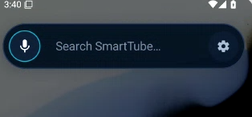
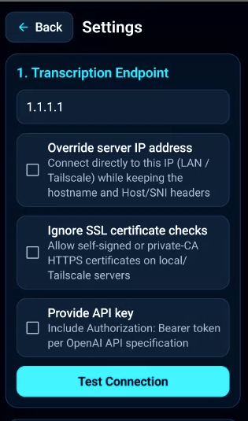
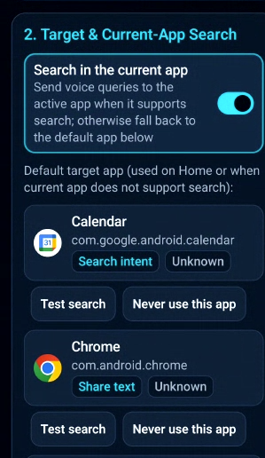

# TV Voice Search

An Android TV / Google TV app that replaces Google's voice search on the remote's mic button. It sends
your voice to **your own speech-to-text (transcription) endpoint** and types the text into the search of
the app you choose.

## Install it with an AI agent

Copy this prompt into your coding agent (Claude Code, Codex, Gemini CLI, ...):

```text
Go to https://github.com/patrick-1984/my-private-assistant and follow docs/AGENT-INSTALL.md step by step
to install TV Voice Search on my Android TV and make it my voice assistant. Ask me before every step
that changes my TV.
```

**What your agent needs.** This is not magic:

- The agent must run on a **computer with a command line** and **`adb`** (Android platform-tools). The
  guide shows how to install `adb`.
- The TV must be **reachable over ADB**: by USB cable, or by Wi-Fi (network / wireless debugging) on the
  same network.
- **You** do a few steps on the TV yourself: turn on Developer options and debugging, accept the
  "Allow debugging" prompt, find the TV's IP address, and type your transcription endpoint (and API key,
  if it needs one) into the app.

Agent guide: [`docs/AGENT-INSTALL.md`](docs/AGENT-INSTALL.md) - short human guide:
[`docs/INSTALL.md`](docs/INSTALL.md).

---

## What it does

- Press the mic button on the remote and speak. The app records your voice, sends it to **your**
  transcription endpoint, and hands the text to an app's search.
- **You choose where the text goes:**
  - By default it goes to **SmartTube**.
  - In **Settings > 2. Target & Current-App Search** you can pick **any installed app with a search
    function** as the default target, for example NewPipe, a web browser, or a media app.
  - With **Search in the current app** turned on (the default), the text goes to the app you are using
    right now, if that app supports search. If it does not (or you are on the home screen), the text
    goes to your default target app. Apps that only accept shared text count as "supports search" too;
    if such an app does something else with the text, mark it **Never use this app**.
- No Google account, no analytics, no Google Play Services. The audio goes only to the endpoint you set.
- Any language your transcription endpoint supports.
- Pure Kotlin, no native code, about 3 MB.

App name on the TV: **TV Voice Search** - package id: `io.github.patrick1984.myprivateassistant`
(named after this repository).

**How it was built:** the app is developed with **Google AI Studio** ("Build an Android app"). AI Studio
generated the first package id, `com.aistudio.tvvoicesearch.qkmzpx`; it was replaced by
`io.github.patrick1984.myprivateassistant` before the first public release. The code namespace is still
`com.example`. The id is set in `app/build.gradle.kts` and is the same for every build (AI Studio, the
GitHub workflow, Android Studio). An app installed under the old id is a separate app: uninstall it and
repeat the ADB setup.

**Updating:** Android updates an installed app in place only when the new APK is signed with the same
key. AI Studio builds and GitHub releases are signed with **different keys**, so to switch between them
you must uninstall first and repeat the ADB setup (assistant, recognizer, accessibility). The error you
see otherwise is `INSTALL_FAILED_UPDATE_INCOMPATIBLE`.

### Why this app exists

On Google TV, the remote's mic button opens Google's own voice search (`com.google.android.katniss`):

- It supports only some languages (for example, no Polish on Google TV).
- It sends results to YouTube or Google's results page. On devices without YouTube, picking a result
  leads to the Play Store.
- It cannot use your own speech-to-text service.

## Screenshots

Screenshots from the Google AI Studio emulator (phone-sized; on a TV the layout is wider).

| Search bar | Settings: transcription endpoint | Settings: target app |
|---|---|---|
|  |  |  |
| The search bar: mic button, text field (here with the default target, SmartTube) and the settings gear. | Section 1: your transcription endpoint (`1.1.1.1` is only a placeholder), optional IP override, ignore SSL checks, API key, and **Test Connection**. | Section 2: **Search in the current app** and the default target app. The emulator has only Calendar and Chrome installed; on a TV the list shows your installed apps (SmartTube, NewPipe, ...). |

## Choosing a transcription endpoint

The app does not do speech recognition itself. It sends a short audio clip to a **transcription
endpoint** that you choose and gets the text back. Any service that speaks the common
**OpenAI-style transcription API** (`POST /v1/audio/transcriptions`) works:

- **Self-hosted, on your own computer or NAS** (private, free): for example Speaches (formerly
  faster-whisper-server), the whisper.cpp server, or LocalAI. The app also understands the whisper.cpp
  `/inference` and whisper-asr-webservice `/asr` paths.
- **A hosted service** with an OpenAI-compatible transcription API and an API key.

In the app: **Settings > 1. Transcription Endpoint**, type the address (for example
`http://<your-server>:<port>` at home, always `https://...` for a service on the internet), turn on
**Provide API key** if the service needs one, then press **Test Connection**. The endpoint must answer
with JSON (`{"text": "..."}`) and, for the first test, accept the model name `whisper-1`; after a
successful test you can pick or type another model under **Pick custom model / endpoint**.

**NVIDIA build.nvidia.com** gives a free trial API key. Two of its speech-to-text models (Parakeet TDT
0.6b, which includes Polish, and Parakeet CTC 1.1b, English) offer an OpenAI-style HTTP endpoint; the
address is on each model page's **API** tab. Using it directly from this app is **not yet verified**
(NVIDIA may reject the app's first-test model name `whisper-1` or its short language codes). Other NVIDIA models, such as
Whisper large v3 and Canary, are gRPC-only and need a small proxy such as LiteLLM in between.

Details, examples and the NVIDIA steps: [`docs/ENDPOINTS.md`](docs/ENDPOINTS.md).

## How it works

```
  remote mic button
        |
        +--> on the home screen: system "assistant" role ------------+
        |      (AssistService / AssistSessionService)                |
        |                                                            v
        +--> inside another app: KEYCODE_SEARCH key ---------> MainActivity
               caught by MicKeyService (accessibility)          (search bar + mic)
                                                                     |
                                                                     | record 16 kHz mono WAV
                                                                     | (stops after ~1.2 s silence, max 10 s)
                                                                     v
                                                  your transcription endpoint
                                                  http://<your-server>:<port>
                                                                     |
                                                                     | text
                                                                     v
                                     current app's search (if "Search in the current app" is on
                                     and the app supports search), otherwise the default target app
                                     (SmartTube by default)
```

Apps that use Android's standard speech recognizer (their own in-app mic button) also get your
endpoint, through `RecognizerService`.

## Architecture

All code lives in `app/src/main/java/com/example/`.

| Component | What it does |
|---|---|
| `AssistService` (`VoiceInteractionService`) + `AssistSessionService` | Holds the system **assistant** role. Receives the mic press from the home screen, takes the remote's audio stream if the system passes one, and opens `MainActivity`. |
| `MicKeyService` (`AccessibilityService`) | Catches the mic key (`KEYCODE_SEARCH`, `KEYCODE_ASSIST`, `KEYCODE_VOICE_ASSIST`) inside other apps and opens the app. It also notes the **package name** of the app in front (from "window changed" events), so the text can go to that app. It reads no screen text or UI content. Settings > **4. Remote Mic & Audio > Mic button capture** stops catching the key; to stop the service completely, remove it from the accessibility settings (see the install guides' undo step). |
| `handoff/ForegroundAppTracker.kt` | Remembers the last app in front; ignores the launcher, Settings, the keyboard and system overlays. |
| `RecognizerService` (`RecognitionService`) | System **speech recognizer**: when another app asks Android to recognize speech, the audio goes to your endpoint. |
| `MainActivity` + `ui/screens/` | Jetpack Compose UI, D-pad friendly: the search bar (mic, text, settings gear) and Settings. |
| `network/EndpointClient.kt` | Endpoint auto-detection, multipart upload, response parsing, model list from `/v1/models`. |
| `handoff/AppHandoff.kt` | Hands the text to the current app or the default target app, with a fallback. |
| `audio/VoiceRecorder.kt` + `audio/WavEncoder.kt` | Records 16 kHz, 16-bit, mono audio (remote stream or built-in mic) as WAV. Stops on silence. |
| `data/SettingsRepository.kt` | Stores settings in private app preferences. |
| `AssistantStatus.kt` | Shows in Settings whether the assistant, recognizer and mic-key service are active, with ADB setup and undo commands. |

**Where the text goes (`AppHandoff`):**

1. **Current app**: if **Search in the current app** is on (default), `MicKeyService` saw an app in
   front, and that app has a direct hand-over (search link, search intent or share text; or you marked
   it "Confirmed" with **Test search**) and is not marked "Not working".
2. Otherwise the **default target app** (SmartTube unless you pick another one).
3. If that fails, the text stays in the search bar and the app offers "Send query to another app:".

How the text is handed over, per app:

| App | Method |
|---|---|
| SmartTube (`org.smarttube.stable` and other SmartTube builds) | Opens a YouTube search link (`https://www.youtube.com/results?search_query=<q>`) only in SmartTube |
| NewPipe (`org.schabi.newpipe`) | Android "share text" |
| Other apps | Android search intent, then web search intent, then "share text". As a last resort the app is opened and the text is copied to the clipboard (default target only, never used for "current app" unless you confirm it) |

In Settings, every app shows its method and a status (Unknown / Confirmed / Not working), with
**Test search** and **Never use this app** buttons.

**Endpoint handling (`EndpointClient`):** you can type a bare host (`<your-server>:<port>`), a base URL
or a full path. Auto-detection tries `/v1/audio/transcriptions`, `/audio/transcriptions`, `/inference`
(whisper.cpp) and `/asr` (whisper-asr-webservice). Without a scheme it tries `http://` first, then
`https://`. Optional: API key (`Authorization: Bearer`), custom model name, IP override (connect to a
fixed IP but keep the hostname for TLS and the `Host` header, for when the TV's DNS cannot resolve your
server), ignore SSL checks (self-signed certificates on a trusted network only), language (Auto, Polish,
English), and live transcription (partial results while you speak; more requests).

## Requirements

- An Android TV / Google TV device with **Android 10 (API 29) or newer**.
- A transcription endpoint the TV can reach (see above).
- A computer with `adb` for the one-time setup. Most Google TV devices have no on-TV menu to change the
  default assistant, so this is done once over ADB. No root is needed.
- Optional: SmartTube, NewPipe or another app with a search function as the target.

Tested on a Google TV projector with Android 14 and a 32-bit ARM CPU. The app has no native code, so the
same APK runs on `armeabi-v7a`, `arm64-v8a` and `x86` devices.

## Install

- Short guide for humans: [`docs/INSTALL.md`](docs/INSTALL.md)
- Detailed guide, written for AI agents (also readable by humans): [`docs/AGENT-INSTALL.md`](docs/AGENT-INSTALL.md)

Download from the [latest release](https://github.com/patrick-1984/my-private-assistant/releases/latest):
one APK and `SHA256SUMS`. Each release has three APKs, all signed with the same key:

| File | For |
|---|---|
| `tv-voice-search-<version>-armeabi-v7a.apk` | older or cheaper TVs and projectors with a 32-bit ARM CPU |
| `tv-voice-search-<version>-arm64-v8a.apk` | modern TVs, set-top boxes and phones (64-bit ARM) |
| `tv-voice-search-<version>-universal.apk` | any device, if unsure (slightly larger) |

Find your device's CPU type with `adb shell getprop ro.product.cpu.abilist`: if it lists `arm64-v8a`,
take that file, otherwise `armeabi-v7a`. The app inside release v1.0.0
reports version 1.1 (versionCode 2, set by AI Studio). Release builds are signed with this repository's
key, not AI Studio's: to switch from an AI Studio install, uninstall it first (see **Updating** above).

## Roadmap

Planned, not built yet:

- **Android phones and tablets**, not only TVs.
- **Speech-to-text built into the device** as an alternative to a server: Android's on-device speech
  recognizer (`SpeechRecognizer.createOnDeviceSpeechRecognizer`, Android 12 and newer) and, where available, the
  on-device dictation / AI models of Samsung, Pixel and other phones. Then dictation would not have to
  send audio or text to any server or cloud service.

## Building

- The app is developed in **Google AI Studio** ("Build an Android app"). Do not change the
  `signingConfigs` block in `app/build.gradle.kts`: AI Studio needs it.
- The package id is `io.github.patrick1984.myprivateassistant` (`applicationId` in
  `app/build.gradle.kts`), named after this repository; it replaced the id AI Studio generated
  (`com.aistudio.tvvoicesearch.qkmzpx`). The code namespace is `com.example`. If AI Studio rewrites
  `applicationId` on a later push, set it back to this id.
- Signing keys differ by source: AI Studio signs with its own key, the GitHub workflow with the keystore
  in the repository secrets, a local build with yours. Android only updates an installed app when the key
  matches; otherwise `adb install -r` fails with `INSTALL_FAILED_UPDATE_INCOMPATIBLE`. Uninstall first,
  then repeat the ADB setup (assistant, recognizer, accessibility).
- **CI build:** [`.github/workflows/build-apk.yml`](.github/workflows/build-apk.yml) builds a signed
  release APK. It runs **only when started by hand** (Actions -> "Build APK" -> Run workflow), with the
  inputs `version` (for example `1.0.1`) and `publish` (create a GitHub release `v<version>`).
  It runs the unit tests, builds `:app:assembleRelease`, and then makes the three APKs
  (`armeabi-v7a`, `arm64-v8a`, `universal`): the per-CPU files are the universal build with the other
  CPU folders removed, zip-aligned and re-signed with the same key. It uploads them with `SHA256SUMS`.
- The workflow needs these repository secrets:
  - `ANDROID_KEYSTORE_BASE64`: the upload keystore (`.jks`), base64-encoded. The key alias must be `upload`.
  - `ANDROID_STORE_PASSWORD`: the keystore password.
  - `ANDROID_KEY_PASSWORD`: the key password.
- Local build: Gradle 9.3.1, JDK 21 and the Android SDK (compileSdk 36). The repo has no `gradlew`
  script, so run `gradle :app:assembleDebug` with a matching Gradle install.

## License

License: not yet chosen.
